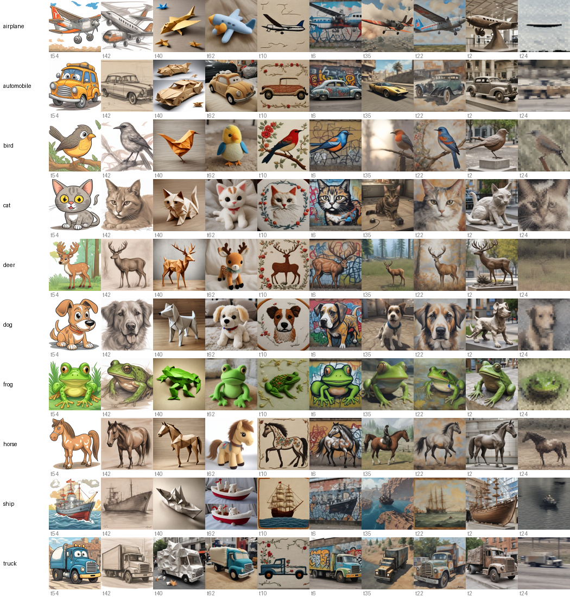
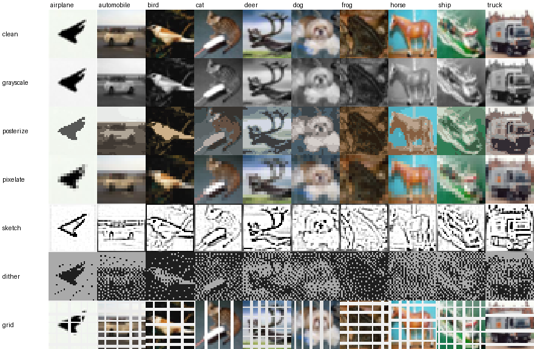

# Learn from Generated Images, not from CIFAR-10

**Zero-shot encoders for Synthetic CIFAR-10** — RecVis 2026 (Master MVA), Assignment 3, Kaggle challenge.

**Public Kaggle accuracy: 96.48 %**, with each test image classified on its own. 📄 [Report (PDF)](report.pdf)

## The problem

The training and validation sets are CIFAR-10 photos, but the 51,077 test images come from
[CIFAR-10-Warehouse](https://arxiv.org/abs/2310.04414): web images, cartoons, sketches, toys and 3D
renders, all downsampled to 32 × 32. A classifier trained on CIFAR-10 learns its content (poses,
backgrounds, car models) as much as the classes, and transfers poorly.

## The approach

1. **Frozen zero-shot encoders.** PE-Core-L/14-336 and PE-Core-bigG/14 at 224 px
   ([Perception Encoder](https://arxiv.org/abs/2504.13181), via OpenCLIP). Each class is the mean text
   embedding of the 80 ImageNet templates published with CLIP.
2. **A head trained on generated images, not on CIFAR-10.** 10,000 images (1,000 per class) generated
   with [SDXL-Turbo](https://arxiv.org/abs/2311.17042) from the same 80 templates, downsampled to 32 px.
   Following [He et al., ICLR 2023](https://arxiv.org/abs/2210.07574), images that the zero-shot model
   misclassifies are dropped, then a logistic regression is fitted on the frozen embeddings.
3. **Combination.** Zero-shot and head logits are temperature-scaled on grayscale validation images and
   mixed with weight 0.5. The two encoders are averaged with equal weights.



*One generated image per class for ten of the 80 templates: cartoon, sketch, origami, plushie,
embroidered, graffiti, video game, painting, sculpture, pixelated photo.*

## Results

| System | Clean val | Gray val | Stylized proxy | Kaggle (public) |
|---|---|---|---|---|
| PE-L zero-shot | 98.6 | 94.7 | 74.1 | 95.56 |
| PE-G + PE-L zero-shot | 98.9 | 95.7 | 78.8 | 96.38 |
| + head on 10k CIFAR-10 photos | 99.6 | 96.6 | 80.5 | 95.88 |
| **+ head on 10k generated images (final)** | 99.0 | 96.3 | 77.6 | **96.48** |

The last two rows differ only in the images the head is trained on. CIFAR-10 photos improve every
validation metric but lose 0.51 on Kaggle. Generated images do the opposite and gain 0.10.
**Learning on CIFAR-10 learns CIFAR-10.**

### Validation: a stylized proxy

Clean validation accuracy is saturated (≈ 99 %), so candidates are compared on 1,000 validation images
rendered in five styles that mimic the test, with a paired McNemar test. The proxy ranked the encoders
correctly but keeps the content of CIFAR-10 photos, so Kaggle has the last word on heads.



*One validation image per class in each style. The proxy averages the last five rows.*

## Reproduce

With [uv](https://docs.astral.sh/uv/) (exact versions pinned in `uv.lock`):

```bash
uv sync
uv run python encode.py --models pe-l14 pe-g14-224                    # ~2 h on a T4
uv run python generate_synthetic.py --name sdxlt-p80 --per-class 1000 \
       --encode pe-l14 pe-g14-224                                    # ~3 h on a T4
uv run python predict.py --head synthetic --filter-zeroshot --output output/E016.csv   # final, 96.48
uv run python predict.py --head none                        --output output/E017.csv   # ablation, 96.38
uv run python predict.py --head cifar                       --output output/E018.csv   # ablation, 95.88
```

Or with pip: `pip install -r requirements.txt`, then the same `python …` commands.

`data/` must hold `train.npz`, `validation.npz`, `test.npz` and `sample_submission.csv` from the
competition (on Kaggle, the folder under `/kaggle/input` is found automatically). All seeds are fixed;
every generated image's prompt and seed are listed in `output/synthetic/sdxlt-p80/metadata.csv`.

Figures:

```bash
uv run python -m figures.plot_synthetic --dir output/synthetic/sdxlt-p80 --source full --seed 7 \
       --templates 54 42 40 62 10 6 35 22 2 24 --out figures/synthetic_styles_full.png
uv run python -m figures.plot_proxy --data data
```

## Repository

| Path | Role |
|---|---|
| `encode.py` | Encodes validation (clean, grayscale, 5 proxy styles), test, a CIFAR-10 training subset and the prompts (GPU) |
| `generate_synthetic.py` | Generates the 10k training images with SDXL-Turbo, then encodes them (GPU) |
| `predict.py` | Trains the heads on cached embeddings, prints validation and proxy accuracy, writes the submission (CPU, ~1 min) |
| `recvis/` | Encoders and embedding cache, data, prompts, proxy styles, heads |
| `figures/` | Figures of the report and the scripts that draw them |
| `report.pdf` | One-page report (CVPR format) |

## External models and data

- PE-Core-L/14-336 and PE-Core-bigG/14-448 (Meta, Apache-2.0), via OpenCLIP (MIT).
- SDXL-Turbo (Stability AI, Stability AI Community License), via diffusers (Apache-2.0).
- CLIP ImageNet prompt templates (OpenAI, Radford et al. 2021).
- No external dataset; CIFAR-10-Warehouse is not used.

## License

Code under the [MIT License](LICENSE). Models and data keep their own licenses.
